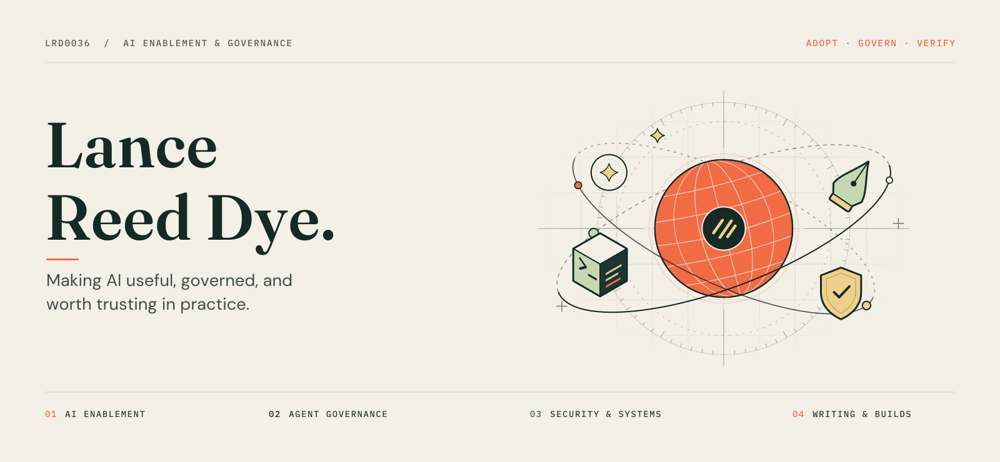

<picture>
  <source media="(prefers-color-scheme: dark)" srcset="assets/cover-dark.svg">
  <source media="(prefers-color-scheme: light)" srcset="assets/cover-light.svg">
  
</picture>

Bottom-up thinking? 

### 

- **AI & trust** — Agent behavior, local models, human judgment, and the boundaries between interpretation, authority, and action.
- **Systems & security** — Reverse engineering, SecOT, Critical Infrastructure, and the ways software decisions become real-world consequences.
- **Code & play** — Rust, simulations, games, procedural graphics, and interactive experiments that make an idea tangible.
- **Language & memory** — Writing, archives, cultural memory, and what gets lost when information survives without its original context. Most of this stuff goes on [boguefala.us](https://boguefala.us)

### A few places to start

| Project | What I'm workin on |
| :--- | :--- |
| [OWASP ACS](https://github.com/genai-security-project/agent-control-standard) | OWASP project to stop skynet |
| [Royal Duke](https://github.com/Lrd0036/SCLC) | Competition presentation for OT-sec. Simulated infrastructure provider gets taken out by privesc + a compromised vendor portal. If I were capable of not being sarcastic, I would just label this is as critical infrastructure security. As long as none of my CISA friends read it, it's fine. |
| [CJIS Security Policy Field Guide](https://github.com/Lrd0036/cjis-secpol-guide) | CJIS isn't exactly easily accessible public information. So! Here's what I have compiled as study resources. |
| [TaxpayerROI](https://github.com/Lrd0036/taxpayer-roi) | Early project of mine. Made for a case competition. Neat idea, horrible execution. |
| [Timberhold](https://github.com/Lrd0036/timberhold-site) | I put out a random little mobile app at one point. I need to pick up some of this work. |
| [Boguefala](https://boguefala.us) | Design portfolio. |
| [The Shoe Room](https://theshoeroom.com) | Web dev and CMS I did for a local business. 

"When you don't know what to do, do something." -Jim Fisk
